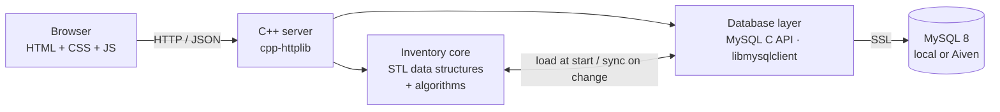

# 02 · Technical Requirements / Design Document (TRD)

## 1. Architecture

- **Frontend:** static files served by the C++ server (`/public`).
- **Backend:** one C++ executable, REST endpoints returning JSON.
- **Database:** MySQL is the permanent source of truth. At start-up products are loaded into memory structures; every change is written to MySQL **inside a transaction**, then the in-memory copy is updated.

## 2. Technology
| Part | Choice |
|---|---|
| Language | C++17 |
| Web server | cpp-httplib (single header) |
| JSON | nlohmann/json (single header) |
| DB access | MySQL C API `libmysqlclient` (prepared statements, SSL, port 3306). Chosen over Connector/C++ because Homebrew's Connector/C++ only offers the X protocol (port 33060), which Aiven does not expose |
| Build | CMake |
| Container | Docker (for Render) |
| Frontend | HTML, CSS, JavaScript (fetch API) |
| Hosting | Render (app), Aiven MySQL (database), GitHub (code) |

## 3. Folder structure
```
ims/
  src/        main.cpp server.cpp routes_*.cpp inventory.cpp sorting.cpp orders.cpp restock.cpp undo.cpp
              database.cpp repository.cpp sqllog.cpp auth.cpp
  include/    one header per source file (product.h, server.h, ...)
  public/     login.html index.html products.html categories.html parties.html purchases.html sales.html
              reports.html users.html model.html bill.html   css/ js/ js/pages/ img/ mock/
  sql/        schema.sql triggers.sql views.sql seed.sql roles.sql syllabus_demo.sql
  scripts/    load_db.sh load_aiven.sh load_roles.sh run_syllabus_demo.sh make_mock.py
  tests/      core_tests.cpp db_tests.cpp api_smoke.py livesql_coverage.py
  docs/       (these documents)
  Dockerfile  render.yaml  CMakeLists.txt  README.md
```

## 4. Data structures (ADS)
| Structure | C++ type | Used for | Complexity |
|---|---|---|---|
| ArrayList | `std::vector<Product>` | Product list, display, sorting | access O(1), append O(1) amortised |
| HashMap | `std::unordered_map<int,Product*>` | Find product by ID | O(1) average |
| Queue | `std::queue<Order>` | Customer orders processed FIFO | O(1) |
| PriorityQueue | `std::priority_queue<LowStockItem>` | Low-stock products, lowest ratio first | O(log n) |
| Stack | `std::stack<StockTxn>` | Undo last stock transaction | O(1) |
| HashSet | `std::unordered_set<std::string>` | Unique SKU check | O(1) average |
| TreeMap | `std::map<int,Product*>` | Products in ID order | O(log n) |

## 5. Algorithms (ADS)
| Algorithm | Where | Written by |
|---|---|---|
| Linear search | Search by name/category | hand-written |
| Binary search | Search by ID in sorted vector | hand-written |
| Merge sort | Sort by price, quantity, name | hand-written |
| Hashing | ID and SKU lookup | `unordered_map/set` |
| FIFO | Order queue | `std::queue` |
| Priority scheduling | Restock list | `std::priority_queue` with custom comparator |

## 6. Data flow for a write (example: record a sale)
1. Browser `POST /api/sales`. 2. Server checks role. 3. Order enters the FIFO queue, is dequeued and processed.
4. Database layer: `START TRANSACTION` → `INSERT Sales` → `INSERT Sale_Items` (BEFORE trigger checks stock; AFTER trigger reduces stock, updates total, writes ledger) → `COMMIT` (or `ROLLBACK` on error).
5. In-memory vector/map updated, low-stock queue re-evaluated. 6. Response contains the result **and the SQL log** for the live panel.

## 7. SQL scope (syllabus only)
Allowed: DDL (CREATE, ALTER, DROP, TRUNCATE), DML (INSERT, UPDATE, DELETE, SELECT with WHERE/ORDER BY/GROUP BY/HAVING), joins (INNER, LEFT, RIGHT), UNION/INTERSECT/EXCEPT, nested queries, aggregates, NULL handling, constraints (PK, FK, UNIQUE, NOT NULL, CHECK, DEFAULT), triggers, views, TCL (COMMIT, ROLLBACK, SAVEPOINT), DCL (GRANT, REVOKE), CREATE INDEX / SHOW INDEX / EXPLAIN, BLOB.
**Not used:** window functions, CTEs, stored procedures/functions, JSON functions, full-text search, partitioning.

## 8. Schema changes versus the DBMS report
The DBMS report schema has 9 tables. The web app adds:
- `Users(user_id, username, password_hash, role)` for login (10th table).
- `Products.photo MEDIUMBLOB` for product images (added with `ALTER TABLE`, which also demonstrates ALTER).
**Assumption to confirm:** the DBMS report will be updated to include these.

## 9. Security
- **SQL:** parameterised queries only; the few places that assemble SQL text use fixed table and column names.
- **Passwords:** PBKDF2-HMAC-SHA256 with a random salt and 100,000 rounds; older SHA-256 hashes are accepted and replaced at the next login. Sign-in is throttled (5 failures per user name or 30 per address block that key for a minute, HTTP 429). Sessions are random server-side tokens in an HTTP-only, `SameSite=Lax` cookie (`Secure` over HTTPS), end after 8 hours, and end at once when the account is deleted, its role changes or its password is reset.
- **Requests:** role check on every endpoint; changes requested from another site are refused (Origin check, 403); one request at a time in strict arrival order (fair ticket lock); body limit 2 MB, photos 1 MB, quantity per line 1,000,000.
- **Responses:** Content-Security-Policy, X-Frame-Options, X-Content-Type-Options, Referrer-Policy, Permissions-Policy on every response (HSTS over HTTPS); only the fixed report list can be run; password hashes are never returned or shown in the SQL log.
- **Operations:** secrets only in environment variables; TLS with certificate check to Aiven; after a dropped database connection the server reconnects by itself (retrying only outside transactions).

## 10. Configuration (environment variables)
`DB_HOST, DB_PORT, DB_USER, DB_PASSWORD, DB_NAME` (database), `DB_SSL_CA` (CA file path) or `DB_SSL_CA_PEM` (CA certificate text), `PORT`, `PUBLIC_DIR`, `SHOP_NAME`, `COOKIE_SECURE`. Sessions are server-side random tokens, so no `SESSION_SECRET` is needed.

## 11. Risks
| Risk | Mitigation |
|---|---|
| Aiven free plan limits / sleep | Develop locally first; wake service before demo; env-var switch back to local |
| Aiven restricts admin rights (GRANT, triggers) | Test script load on day one |
| Render free tier sleeps | Wake before demo |
| `libmysqlclient` build on Windows | Use Docker or prebuilt client library; document in README |
