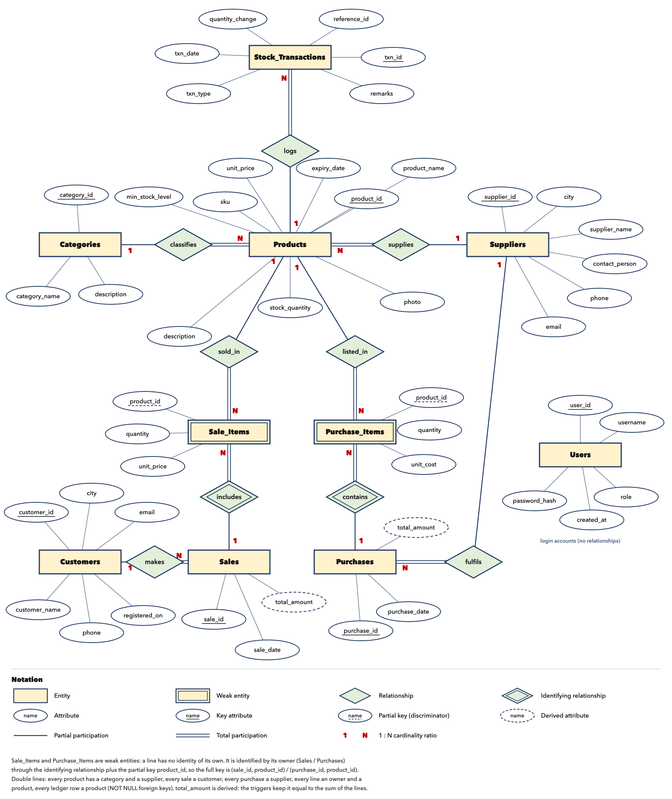
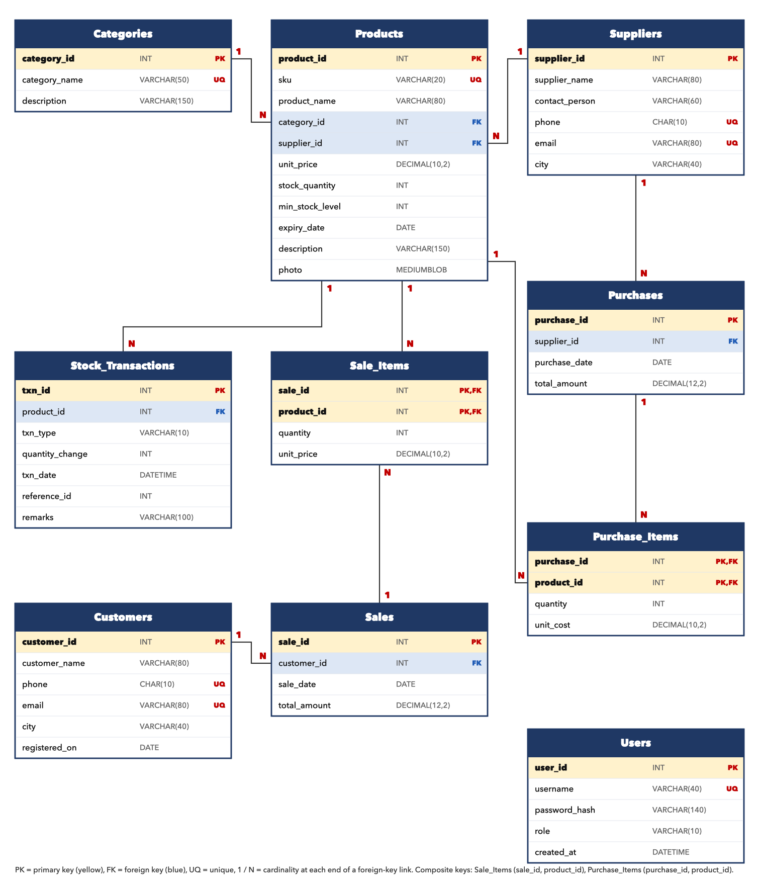

# 04 · Database Design
Source: DBMS report (Sections 3–4), executed and verified on MySQL 8.0.46. Additions for the web app are marked **NEW**.

## Tables (10)
Categories, Suppliers, Customers, Products (+ **NEW** `photo MEDIUMBLOB`), Purchases, Purchase_Items, Sales, Sale_Items, Stock_Transactions, **NEW** Users.

## ER diagram

Chen notation (Elmasri & Navathe, Korth):
- **Weak entities** `Sale_Items` and `Purchase_Items` are double rectangles. A sale line has no identity of its own: it is identified by its owner
  (`Sales` / `Purchases`) through an **identifying relationship** (double diamond: `includes`, `contains`) plus its **partial key** (discriminator)
  `product_id`, drawn with a **dashed underline**. Full key = owner key + partial key: `(sale_id, product_id)`, `(purchase_id, product_id)`.
- **Total participation** (double line) wherever the foreign key is `NOT NULL`: every product has a category (`classifies`) and a supplier (`supplies`),
  every sale a customer (`makes`), every purchase a supplier (`fulfils`), every ledger row a product (`logs`), every line an owner and a product
  (`includes`/`contains`, `sold_in`/`listed_in`). The other side of each relationship is partial (single line): a category may have no products yet.
- Key attributes are underlined; `total_amount` is a **derived attribute** (dashed ellipse) kept equal to the sum of the lines by the triggers.
- `Users` (login accounts) stands alone: it has no relationships.

## Relational schema

Both figures are drawn by `scripts/make_diagrams.py` (SVG for the app's Database Model page, PNG here with `--png`).

## Normalization
All report tables are in BCNF (functional dependencies in the DBMS report, Table 3.7). `Sales.total_amount` and `Purchases.total_amount` are deliberate derived columns maintained by triggers.

## Constraints
PRIMARY KEY, FOREIGN KEY (RESTRICT/CASCADE), UNIQUE (sku, phone, email, username), NOT NULL, CHECK (price > 0, stock ≥ 0, txn_type, phone format), DEFAULT.

## Triggers
| Trigger | Event | Action |
|---|---|---|
| trg_purchase_items_ai | AFTER INSERT on Purchase_Items | stock += qty, purchase total += line, ledger row |
| trg_sale_items_bi | BEFORE INSERT on Sale_Items | SIGNAL error if qty > stock |
| trg_sale_items_ai | AFTER INSERT on Sale_Items | stock -= qty, sale total += line, ledger row |
| trg_sale_items_ad | AFTER DELETE on Sale_Items | stock += qty, sale total -= line, ledger row (UNDO). Used by Undo |
| trg_purchase_items_ad | AFTER DELETE on Purchase_Items | stock -= qty (CHECK refuses if already sold), purchase total -= line, ledger row (UNDO) |
| trg_sale_items_bu | BEFORE UPDATE on Sale_Items | SIGNAL error: lines are never edited in place |
| trg_purchase_items_bu | BEFORE UPDATE on Purchase_Items | SIGNAL error: lines are never edited in place |

**Why the CHECK matters more than the trigger:** `trg_sale_items_bi` reads the stock without locking it, so two buyers at the same moment can both pass it. `CHECK (stock_quantity >= 0)` on `Products` then stops the second one when its stock update runs (tested: stock 10, exactly one sale). Do not remove the CHECK.
**No silent cascade:** `Sale_Items` and `Purchase_Items` reference their sale or purchase with `ON DELETE RESTRICT`. A cascade would delete lines without firing triggers and leave stock, totals and ledger out of step; lines are deleted explicitly instead (Undo).
**Passwords:** `Users.password_hash` holds `pbkdf2-sha256$rounds$salt$hex` (PBKDF2-HMAC-SHA256, 100,000 rounds).

## Views
`v_low_stock`, `v_sales_summary`, `v_product_catalogue`.

## Indexes
Primary key (clustered), UNIQUE sku, foreign-key indexes, `idx_products_name`, composite `(category_id, unit_price)`; EXPLAIN demo in the Lab.

## Roles (DCL)
`ims_admin` (all privileges on the database), `ims_employee` (SELECT on views and tables, INSERT on Sales/Sale_Items/Purchases/Purchase_Items; no DELETE). The web app login role maps to which database account the Lab demo uses.
**To verify on Aiven:** whether CREATE USER / GRANT work for the admin account.

## Scripts
`sql/schema.sql`, `sql/triggers.sql`, `sql/views.sql`, `sql/seed.sql`, `sql/roles.sql`, and `sql/syllabus_demo.sql` (one runnable example per syllabus topic; captured output in `12-Syllabus-Demo-Output.md`).
