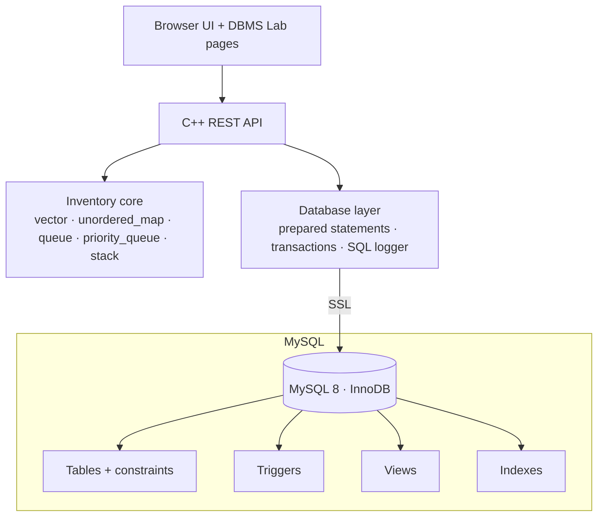
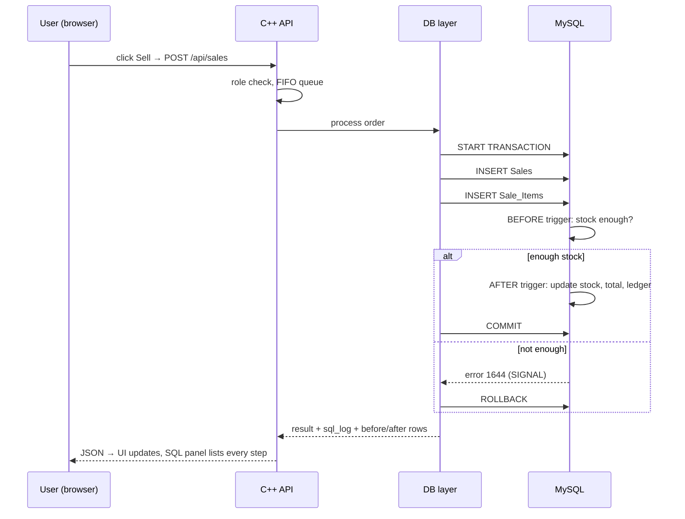
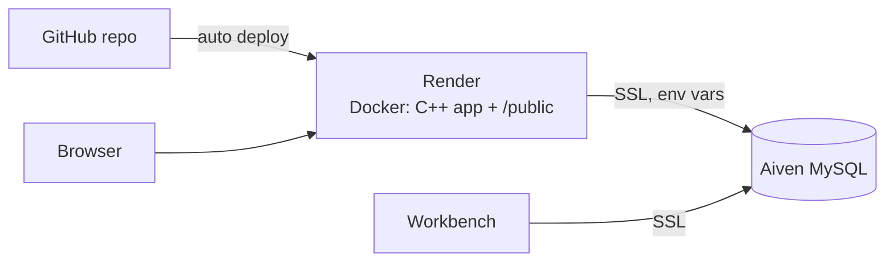

# 05 · Database Architecture and Workflow

## 1. Layers

## 2. What happens on Add / Update / Delete / Sell (shown live in the SQL panel)

## 3. Live SQL panel contents
For each action: (1) SQL text in execution order, (2) trigger notes, (3) rows before and after, (4) MySQL error and `ROLLBACK` when something fails, (5) time taken and rows affected. The C++ DB layer appends every statement to a per-request log (`sqllog.cpp`) and returns it with the response.

## 4. Startup and sync
1. Connect to MySQL (SSL). 2. `SELECT` products and load the vector, hash map and tree map. 3. Build the low-stock priority queue. 4. Serve requests. All writes go to MySQL first; memory is updated only after a successful COMMIT, so memory never holds data the database rejected.

## 5. Deployment

## 6. What cannot be shown live
Internal MySQL mechanisms (undo/redo logs, lock manager, ARIES recovery) are not visible from the application; they are explained in the DBMS report. Lock-wait and deadlock demos are possible from two sessions but are optional.
